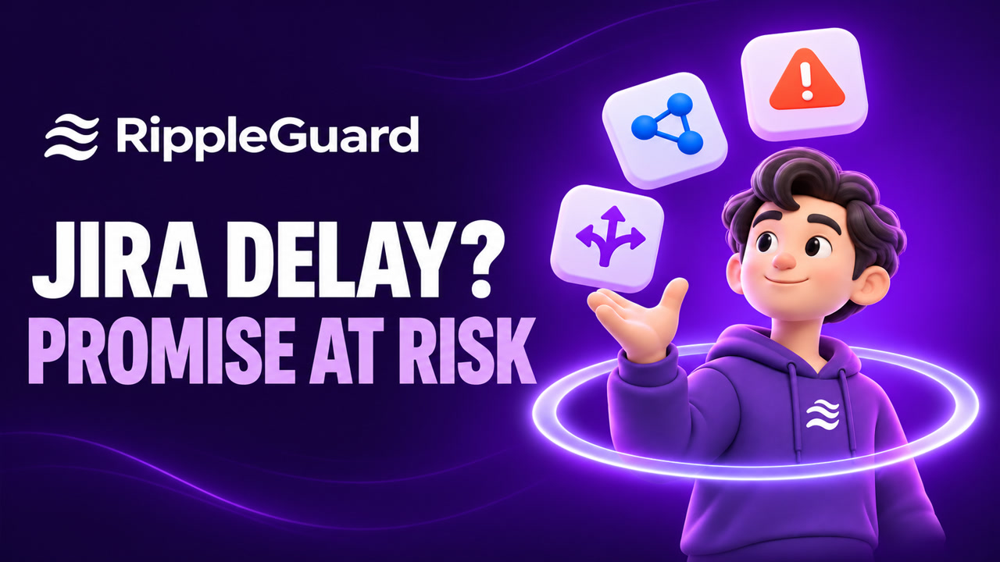

<div align="center">
  
  <h1>RippleGuard</h1>
  <p><strong>See which customer promises are at risk when Jira work changes.</strong></p>
  <p>Atlassian Codegeist 2026 · Apps for Business Teams</p>
  <p>
    <a href="#watch-the-demo">Watch the demo</a> ·
    <a href="#judge-walkthrough">Judge walkthrough</a> ·
    <a href="#run-from-source">Run from source</a> ·
    <a href="#tech-stack">Tech stack</a>
  </p>
</div>

## Watch the demo

[](https://youtu.be/0NEaJ8ICcg0)

[Watch on YouTube](https://youtu.be/0NEaJ8ICcg0) (4:21, with narration and captions) · [Download the MP4](https://raw.githubusercontent.com/rcconstante/ripple-guard/main/docs/media/rippleguard-demo.mp4)

The demo follows a fictional customer promise from Confluence through a Jira due date change, the Impact Explorer, a confirmed mitigation Task, and read-only Rovo and MCP queries. The risk and its evidence appear around 1:41, Rovo around 3:07, and MCP around 3:39.

## What RippleGuard does

A delivery date can move in Jira while the customer promise stays buried in a document. RippleGuard ties a recorded promise to the Jira issues that deliver it and shows what changed, which promise it affects, and why.

| Capability | What to look for |
| --- | --- |
| **Commitments and dashboard** | Record a promise with its date, source link, excerpt, and Jira issues. Filter active commitments by On track, At risk, Overdue, or Needs review. |
| **Jira issue panel and change detection** | See the commitments linked to an issue. Relevant Jira updates trigger risk recalculation. |
| **Impact Explorer** | Trace links confirmed by the user. When Teamwork Graph is available, suggested Jira context appears separately and never affects the risk status. |
| **Mitigation** | The owner reviews a draft and explicitly confirms creation of one Jira Task per commitment. |
| **Rovo and MCP** | Ask which commitments are at risk, why a commitment has its status, or which commitments an issue may affect. All three tools are read-only. |

## Judge walkthrough

Use a Jira Cloud site and a Jira project with the **Task** issue type. A Jira admin needs the production Forge installation link from the maintainer. Open **Apps → RippleGuard** in Jira after installation.

1. Create a test Task due 10 days from today. Record a promise to deliver in 20 days, use the Task URL as the source, and paste a short fictional promise as the excerpt. Link the Task and save. The commitment should be **On track**.
2. Change the Task due date to 30 days from today. Reopen the commitment. It should show **At risk**, the linked issue, and both dates. The Jira issue's **RippleGuard** panel should show the commitment.
3. Choose **View impact** to see the explicit link. A suggested dependency appears separately if Teamwork Graph returns one.
4. Choose **Create mitigation Jira issue**, review the draft, and confirm. Reopen the commitment to see the existing mitigation link. This step requires Jira's **Create Issues** permission.
5. On a Rovo-enabled site, open **Ask Rovo → Agent selector → Browse agents → RippleGuard Impact Agent** and ask “Which of my accessible commitments are at risk?” Then ask why the demo promise is at risk.
6. For external MCP, follow the [admin setup and tool guide](docs/DEMO_SUBMISSION.md#external-mcp). This is optional for the core Jira walkthrough.

See [judge and release instructions](docs/DEMO_SUBMISSION.md) for setup, expected results, and verification limits.

## Run from source

You need **Node.js 24**, npm, the Atlassian Forge CLI, and admin access to a Jira Cloud development site. Forge hosts the UI, functions, and data.

```bash
git clone https://github.com/rcconstante/ripple-guard.git
cd ripple-guard
npm install --global @forge/cli
forge login
npm ci
npm run check
```

`npm ci` installs both the backend and frontend dependencies from their lockfiles. `npm run check` runs TypeScript, frontend and backend lint, Forge lint, and the production UI build.

Repository contributors can deploy the registered app as-is. To deploy an independent copy with your own Forge account, run `forge register` once from the repository root. It assigns a new app ID to your local manifest. Use that ID for your own deployments and MCP URL.

```bash
forge deploy --environment development
forge install --environment development --product Jira --site YOUR-SITE.atlassian.net
```

For an Atlassian demo site with Rovo, use `forge site provision` and substitute the returned site in the install command. For an existing installation that requires new scope consent, add `--upgrade` to the install command. [Forge demo site guide](https://developer.atlassian.com/platform/forge/provision-a-demo-development-site/)

For live development, run `npm run dev` and `npm run tunnel` in separate terminals, then open the installed app in Jira.

## Tech stack


| Layer | Technology |
| --- | --- |
| Jira UI | Forge Custom UI, React, TypeScript, Vite, Tailwind CSS, Radix UI and React Flow |
| Runtime and storage | Forge functions and resolvers on Node.js 24, Forge KVS |
| Jira integration | Jira REST API and the Jira issue-updated event |
| Context and assistant | Teamwork Graph, Forge LLM for evidence-grounded wording, Rovo agent and skill, and Forge MCP |

## Architecture and permissions

Jira changes trigger Forge to recalculate the risk for linked active commitments. The risk engine compares dates in UTC and applies fixed rules. Forge LLM can explain the evidence in plain language. The dashboard, issue panel, Rovo agent, and MCP tools use the same permission checks. A commitment is visible only when the caller can read every linked Jira issue.

- [Feature scope and risk rules](docs/FEATURE_SCOPE.md)
- [Architecture and data flow](docs/ARCHITECTURE.md)
- [Manual acceptance checklist](docs/TEST_MATRIX.md)
- [Codegeist submission rules](https://codegeist2026.devpost.com/rules)
